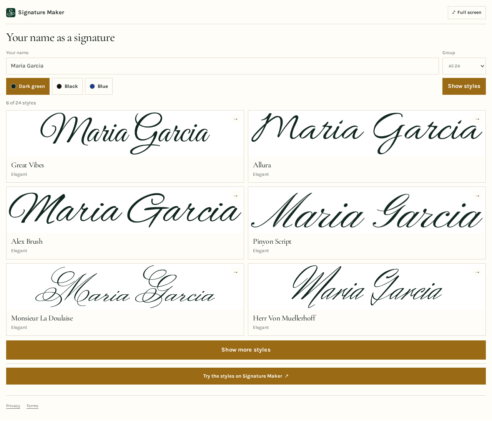
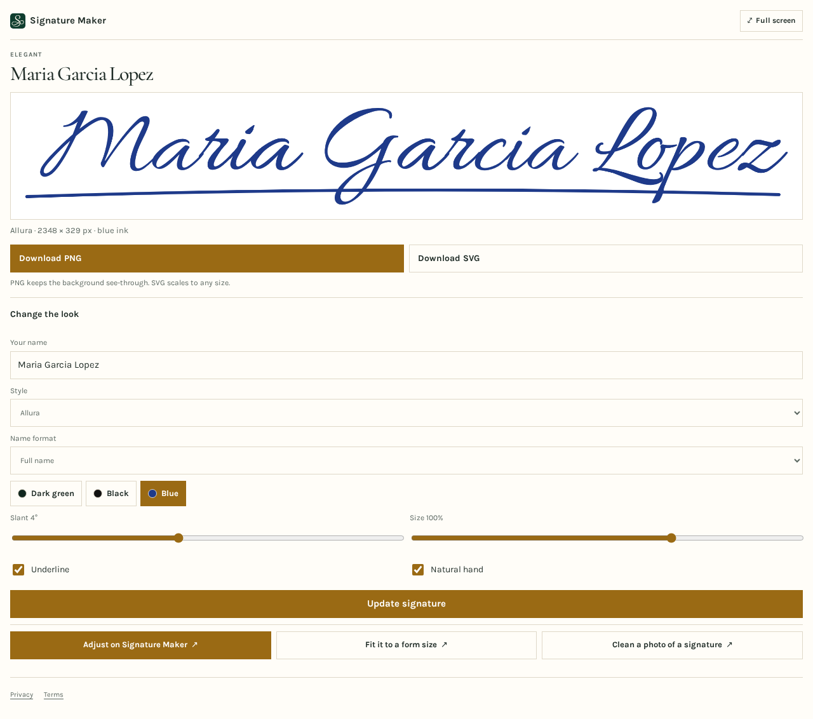
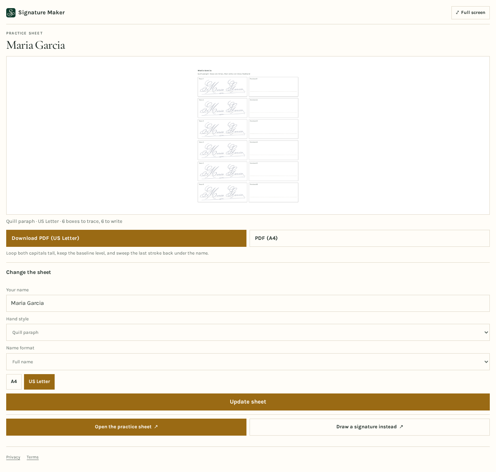

# Signature Maker MCP server


Signature Maker is a hosted, read-only [Model Context Protocol](https://modelcontextprotocol.io) server that writes a typed name as a signature. An AI assistant can use it to show a name in 24 signature styles, make one signature with the ink, slant, size and underline you choose, list handwritten versions, suggest ideas for the first capital letter and make a printable practice sheet. In hosts that support MCP Apps (ChatGPT, Claude) it shows the pictures with PNG, SVG and PDF downloads.

- Website: https://signaturemaker.io
- MCP endpoint: `https://signaturemaker.io/api/mcp` (Streamable HTTP, no sign-in)
- Documentation: https://signaturemaker.io/app
- Official MCP Registry name: `io.signaturemaker/signature-maker`

This repository holds the public server description, icons and connection instructions. The server itself is hosted at signaturemaker.io, so there is nothing to install or run locally.

## Tools

All tools are read-only.

| Tool | What it does |
|---|---|
| `make_signature` | A name as a signature in one of 24 styles with name format, slant, size, underline, ink and natural hand, as a transparent PNG and an SVG |
| `signature_styles` | The 24 styles (elegant, casual, bold) written with the name, each with a link to open it on the site |
| `handwritten_signature` | 18 handwritten versions: six hand styles in each of three name formats, with PNG and SVG |
| `signature_ideas` | Ideas for the first capital letter A to Z: three ways to draw it, how to start and join it, and six hand styles on the name |
| `signature_practice_sheet` | A practice sheet with six boxes to trace and six to write freehand, as a PDF on A4 or US Letter and a picture of the page |

- Style ids are returned by `signature_styles`; `ink` takes `green`, `black`, `blue` or a hex colour such as `#1e3a8a`.
- Names are 1 to 60 characters.

## Connect

### ChatGPT and Claude

Add a custom connector with the URL `https://signaturemaker.io/api/mcp` and choose no authentication.

### Claude Desktop, Cursor and other MCP clients

```json
{
  "mcpServers": {
    "signature-maker": {
      "url": "https://signaturemaker.io/api/mcp"
    }
  }
}
```

Clients that only launch local servers can connect through a bridge such as [`mcp-remote`](https://www.npmjs.com/package/mcp-remote):

```json
{
  "mcpServers": {
    "signature-maker": {
      "command": "npx",
      "args": ["-y", "mcp-remote", "https://signaturemaker.io/api/mcp"]
    }
  }
}
```

## Try asking

- "Show my name, Maria Garcia, in the signature styles."
- "Make a signature for Maria Garcia Lopez in blue ink with an underline."
- "Give me ideas for starting a signature with a capital K."
- "Make a practice sheet to trace Maria Garcia on US Letter paper."

## On the website

- [Signature maker](https://signaturemaker.io/)

## Screenshots

| Styles | Signature | Practice sheet |
|---|---|---|
|  |  |  |

## Privacy and support

- Privacy: https://signaturemaker.io/privacy/
- Terms: https://signaturemaker.io/terms/
- Support: https://signaturemaker.io/contact/ or abishop1933@gmail.com

Signature Maker has no accounts. The name typed in the chat is sent to the server to draw the picture and is not stored; it appears in the address of the picture or file, and the hosting provider keeps standard request logs for a short time.

To report a problem, open an issue in this repository or write to abishop1933@gmail.com.

## License

The text and icons in this repository are released under the [MIT License](LICENSE). The Signature Maker website, its content and brand are not covered by it.
